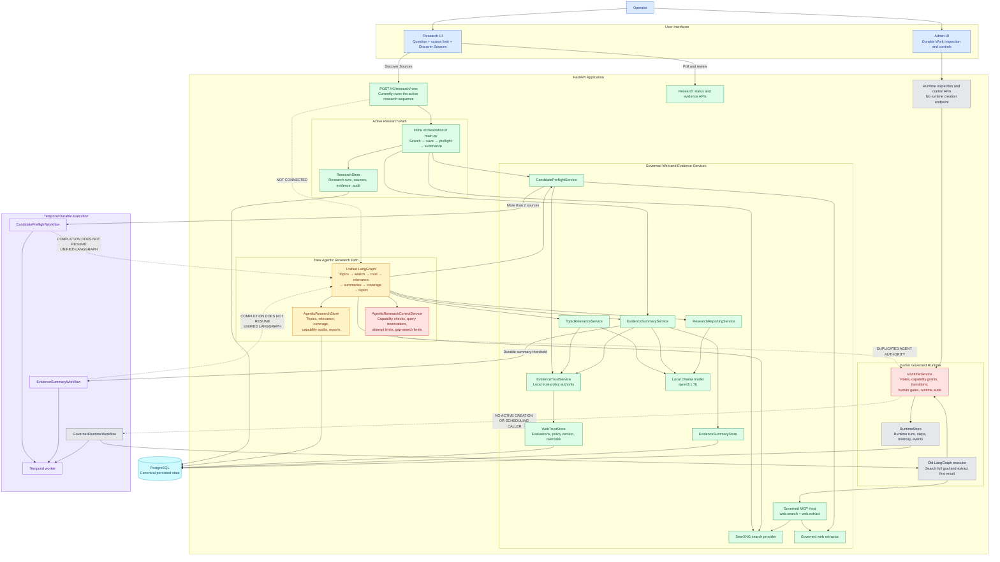

# Current Platform Architecture

This diagram is the current-state architecture reference for design reviews. It
shows active production paths, implemented but disconnected components,
overlapping authority, older runtime infrastructure, and missing durable
continuation links. Update it whenever one of these relationships changes.

See the [Architecture Diagram Glossary](architecture-glossary.md) for the
purpose, inputs, outputs, and connections of every entity shown below.

## Legend

- **Green:** active production path or established service.
- **Yellow:** implemented but not connected to the operator workflow.
- **Red:** overlapping agent-authority responsibilities requiring consolidation.
- **Gray:** earlier runtime infrastructure without an active creation path.
- **Purple:** Temporal durable execution.
- **Dotted lines:** missing connection, inactive path, or architectural conflict.

## Reconciliation points

1. **Discover Sources still uses inline orchestration**, not the unified
   LangGraph.
2. **`AgenticResearchControlService` and `RuntimeService` overlap** in capability
   and workflow authority.
3. **Temporal completion cannot resume the unified graph**, while the current
   preflight worker can still start summaries outside the new relevance stage.

The Local Trust Policy is not duplicated. `EvidenceTrustService` remains its
independent authority and is used by both the active and proposed research
paths.
